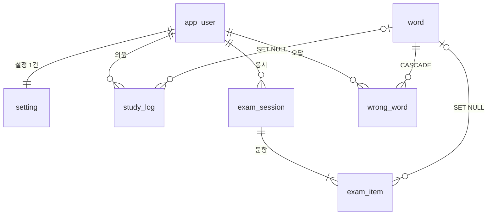

# 스마트 보카 데이터 설계서 (Data Design)

**파일 위치**: `docs/설계_261111_데이터 설계서.md`
**작성일**: 2026-11-11
**버전**: v1.3
**설명**: SQLite 테이블 정의(논리·물리 모델), DB 위치·생성·트랜잭션 정책, 단어장 CSV 형식과 검증 규칙을 정의한다.

---

## 변경 이력

| 버전 | 일자 | 변경 내용 |
|------|------|-----------|
| v1.0 | 2026-11-11 | 초안 작성 |
| v1.1 | 2026-11-18 | 기본 단어장 파일명 `data/toeic_words.csv` 로 변경 반영 (ADR-15) |
| v1.2 | 2026-11-25 | 일차 잠금 폐지 반영 (ADR-21): 일차 상태 열거와 예시 설명 수정. 저장 형식은 그대로 |
| v1.3 | 2026-11-25 | 기말 과제 대응: 학습 기록 JSON 을 SQLite 7개 테이블로 전환 (ADR-25). 테이블 정의서, DB 위치(`DB_PATH`)·자동 생성·트랜잭션 정책, 일차 상태 계산(ADR-26), CSV 헤더 2종·중복 건너뜀(ADR-28), VOCA-FR/NFR 대응표. JSON·손상 파일 보존·원자적 쓰기 폐기 |

---

## 1. 개요

| 항목 | 내용 |
|------|------|
| 관련 이슈 | #4 [Docs] 데이터 설계서 작성 |
| 입력 문서 | 기획서 §7, `분석_261111_요구사항 명세서.md`, 과제 소프트웨어 요건(`ai-agent/uploads/2026-final/02_소프트웨어 요건.md`) |
| 후속 문서 | 프로세스 설계서, 시스템 구조, 결정 기록 |
| 과제 요건 | VOCA-SUB-015 데이터 설계서(테이블 정의), VOCA-NFR-002·003 |

프로그램이 다루는 데이터는 두 가지다.

- **SQLite DB 1개** (`DB_PATH`): 단어, 설정, 암기 이력, 시험 이력, 오답 목록. 프로그램이 읽고 쓰는 유일한 상태 데이터다.
- **단어장 CSV**: 기본 단어장 `data/toeic_words.csv`(읽기 전용, 처음 한 번 DB 에 등록), 사용자가 올리는 CSV(메모리에서만 읽음), 내보내기 CSV(다운로드로만 보냄).

SQL 은 `src/smartvoca/storage/repository.py` 에만, 테이블 정의는 `src/smartvoca/storage/db.py` 의 `SCHEMA` 에만 둔다.

---

## 2. 결정 기록

| ID | 결정 | 근거 |
|----|------|------|
| DD-01 | 학습 기록은 SQLite 에 둔다 (2026-11-25, 이전: JSON) | 과제가 DB 이력 관리와 SQLite 를 요구(VOCA-NFR-002). 표준 라이브러리 `sqlite3` 라 의존성이 늘지 않는다. 통계를 SQL 로 집계할 수 있다(VOCA-FR-034). ADR-25 |
| DD-02 | DB 위치는 환경변수 `DB_PATH`, 없으면 `userdata/voca.db` | 서버는 `/data` 에만 쓸 수 있다(R-06). 경로는 `paths.db_path()` 한곳에서 정한다 |
| DD-03 | 단어는 정수 `id` 로 가리키고, 이력에는 영단어 글자도 함께 남긴다 | 단어를 고치거나 지워도 이력이 깨지지 않게 한다. 지운 단어의 이력은 `word_id` 가 NULL, `word` 글자로 남는다 |
| DD-04 | 일차·일차 상태는 저장하지 않고 계산한다 | 하루 학습량·단어 추가·삭제로 일차 번호가 바뀌어도 어긋나지 않는다. ADR-26 |
| DD-05 | 사용자 열(`user_id`)을 처음부터 둔다 | 지금은 기본 사용자 1명(`id=1`, `guest`). 로그인(VOCA-FR-041~043)을 붙일 때 스키마를 바꾸지 않는다 |

---

## 3. 논리 데이터 모델

| 엔터티 | 종류 | 설명 |
|--------|------|------|
| `app_user` | 기준 | 학습자. 기본 사용자 1명 |
| `word` | 기준 | 단어장. `id` 순서가 단어장 순서(일차 편성 순서) |
| `setting` | 기준 | 사용자별 설정 (하루 학습량, 복습 카드 수, 시험 기본값) |
| `study_log` | 이력 | 암기 이력 — 누가·언제·어느 단어·몇 일차 (VOCA-FR-014) |
| `exam_session` | 이력 | 시험 1회 — 종류·방향·형식·점수 |
| `exam_item` | 이력 | 시험 문항 1개 — 단어·형식·방향·정오·시각 (VOCA-FR-026) |
| `wrong_word` | 상태 | 오답 목록 — 누적 오답, 연속 정답, 목록 등재 여부 (FR-17, FR-25) |

---

## 4. 테이블 정의서 (물리 모델)

공통: SQLite 타입은 `INTEGER`·`TEXT` 만 쓴다. 시각은 로컬 시각 ISO 문자열(`YYYY-MM-DDTHH:MM:SS`, 초 단위)이며 `AppSession._now()` 가 만든다. 참/거짓은 `INTEGER` 0/1.

### 4.1 `app_user` — 사용자

| 열 | 타입 | 제약 | 설명 |
|----|------|------|------|
| `id` | INTEGER | PK | 사용자 번호. 기본 사용자는 1 (`DEFAULT_USER_ID`) |
| `name` | TEXT | NOT NULL, UNIQUE | 이름. 기본 `guest` |
| `created_at` | TEXT | NOT NULL | 만든 시각 |

### 4.2 `word` — 단어

| 열 | 타입 | 제약 | 설명 |
|----|------|------|------|
| `id` | INTEGER | PK | 단어 번호. 등록 순서 = 단어장 순서 |
| `word` | TEXT | NOT NULL, UNIQUE COLLATE NOCASE | 영단어. 대소문자만 다른 단어는 중복으로 막는다 (최대 100자, `MAX_WORD_LENGTH`) |
| `meaning` | TEXT | NOT NULL | 뜻 칸 원문 (최대 300자, `MAX_MEANING_LENGTH`) |
| `created_at` | TEXT | NOT NULL | 등록 시각 |
| `updated_at` | TEXT | NOT NULL | 마지막 수정 시각 |

### 4.3 `setting` — 설정 (VOCA-FR-061, 062)

| 열 | 타입 | 제약 | 설명 |
|----|------|------|------|
| `user_id` | INTEGER | PK, FK → `app_user.id` ON DELETE CASCADE | 사용자 |
| `day_size` | INTEGER | NOT NULL | 하루 학습량, 5~100 (기본 20) |
| `review_count` | INTEGER | NOT NULL | 일차 학습에 섞는 복습 카드 수, 0~20 (기본 4) |
| `exam_count` | INTEGER | NOT NULL | 실력 시험 문제 수 기본값, 1~100 (기본 20) |
| `exam_direction` | TEXT | NOT NULL | `en_ko` / `ko_en` / `mix` (기본 `en_ko`) |
| `exam_format` | TEXT | NOT NULL | `choice` / `short` / `ox` (기본 `choice`) |
| `updated_at` | TEXT | NOT NULL | 저장 시각 |

알 수 없는 값이 들어 있으면 `repository.get_settings` 가 기본값(`Settings()`)을 돌려준다. 범위 검사는 `core/validation.py` `parse_settings` 가 한다.

### 4.4 `study_log` — 암기 이력 (VOCA-FR-014)

| 열 | 타입 | 제약 | 설명 |
|----|------|------|------|
| `id` | INTEGER | PK | |
| `user_id` | INTEGER | NOT NULL, FK → `app_user.id` ON DELETE CASCADE | 누가 |
| `word_id` | INTEGER | FK → `word.id` ON DELETE SET NULL | 어느 단어 (지운 단어면 NULL) |
| `word` | TEXT | NOT NULL | 그때의 영단어 글자 |
| `day_no` | INTEGER | | 몇 일차 (오답 학습이면 NULL) |
| `kind` | TEXT | NOT NULL | `new`(그 일차 단어) / `review`(전날 단어) / `wrong`(오답 단어) |
| `studied_at` | TEXT | NOT NULL | 언제 |

인덱스: `idx_study_log_user_word (user_id, word_id)`. 카드 묶음을 **모두 본 순간** 카드마다 한 줄씩 남긴다(도중에 나가면 남기지 않음, D-03). 같은 일차를 다시 보면 다시 남는다.

### 4.5 `exam_session` — 시험 1회

| 열 | 타입 | 제약 | 설명 |
|----|------|------|------|
| `id` | INTEGER | PK | 회차 |
| `user_id` | INTEGER | NOT NULL, FK → `app_user.id` ON DELETE CASCADE | |
| `kind` | TEXT | NOT NULL | `day`(일차 시험) / `wrong`(오답 시험) / `random`(실력 시험) |
| `day_no` | INTEGER | | 일차 시험의 일차 |
| `direction` | TEXT | NOT NULL | 고른 방향 (`mix` 일 수 있음) |
| `format` | TEXT | NOT NULL | 고른 형식 |
| `total` | INTEGER | NOT NULL | 문항 수 |
| `correct` | INTEGER | NOT NULL | 맞힌 수 |
| `finished_at` | TEXT | NOT NULL | 제출 시각 |

### 4.6 `exam_item` — 시험 문항 (VOCA-FR-026)

| 열 | 타입 | 제약 | 설명 |
|----|------|------|------|
| `id` | INTEGER | PK | |
| `session_id` | INTEGER | NOT NULL, FK → `exam_session.id` ON DELETE CASCADE | 회차 |
| `user_id` | INTEGER | NOT NULL, FK → `app_user.id` ON DELETE CASCADE | |
| `word_id` | INTEGER | FK → `word.id` ON DELETE SET NULL | 단어 (지운 단어면 NULL) |
| `word` | TEXT | NOT NULL | 그때의 영단어 글자 |
| `format` | TEXT | NOT NULL | 형식 |
| `direction` | TEXT | NOT NULL | 이 문항에 실제로 정해진 방향 (`en_ko`/`ko_en`) |
| `prompt` | TEXT | NOT NULL | 보여 준 문제 (영단어 또는 뜻) |
| `correct_answer` | TEXT | NOT NULL | 정답 |
| `given_answer` | TEXT | NOT NULL | 고르거나 적은 답 (OX 는 `O`/`X`) |
| `is_correct` | INTEGER | NOT NULL | 정오 0/1 |
| `answered_at` | TEXT | NOT NULL | 시각 |

인덱스: `idx_exam_item_user_word (user_id, word_id)`.

### 4.7 `wrong_word` — 오답 목록 (FR-17, FR-22, FR-25)

| 열 | 타입 | 제약 | 설명 |
|----|------|------|------|
| `user_id` | INTEGER | PK(1), FK → `app_user.id` ON DELETE CASCADE | |
| `word_id` | INTEGER | PK(2), FK → `word.id` ON DELETE CASCADE | 단어를 지우면 함께 지운다 |
| `wrong_count` | INTEGER | NOT NULL DEFAULT 0 | 누적 오답 횟수 (목록에서 빠져도 유지, D-06) |
| `streak` | INTEGER | NOT NULL DEFAULT 0 | 오답 시험 연속 정답 (0 ~ 2) |
| `in_list` | INTEGER | NOT NULL DEFAULT 0 | 오답 목록 등재 여부 |

목록 순서: `wrong_count` 내림차순, 같으면 `word_id`(단어장 순서). 변경 규칙은 `core/progress.py` `apply_exam_to_wrong_records` 가 계산하고 `repository.save_wrong_records` 가 UPSERT 한다.

---

## 5. 저장소 정책

### 5.1 위치와 생성 (VOCA-NFR-002, 003, R-06)

| 실행 | DB 파일 | 정하는 곳 |
|------|---------|-----------|
| 학교 서버 (Docker) | `/data/voca.db` | Dockerfile `ENV DB_PATH`, `/data` 는 UID 10001 소유 |
| 내 PC (`python -m smartvoca`) | `userdata/voca.db` (환경변수가 없을 때) | `paths.db_path()` |

- `AppSession.open` → `db.init_db` 가 시작할 때마다 `CREATE TABLE IF NOT EXISTS` 로 테이블·인덱스를 만들고, 기본 사용자와 기본 설정을 `INSERT OR IGNORE` 로 넣는다. 빈 DB 에서 시작할 수 있다.
- **기본 단어장은 처음 만든 DB 에 한 번만** 넣는다. `PRAGMA user_version` 이 0 이면 처음으로 보고 `data/toeic_words.csv`(2,109개)를 넣은 뒤 1 로 바꾼다. 사용자가 단어를 모두 지운 뒤 다시 켜도 되살아나지 않는다. 기본 단어장을 읽을 수 없으면 시작하지 않는다(`ValueError`).
- 연결마다 `PRAGMA foreign_keys = ON` 을 켠다(`db.connect`). 폴더가 없으면 만든다.

### 5.2 트랜잭션

- `AppSession` 의 메서드 하나가 `db.transaction()` 하나다. 성공하면 commit, 예외면 rollback 이므로 "채점 결과는 남았는데 오답 목록은 안 바뀜" 같은 반쪽 기록이 없다.
- 연결은 메서드마다 열고 닫는다. 서버가 여러 스레드에서 요청을 받아도 연결을 나눠 쓰지 않는다.
- 저장 버튼은 없다. 암기 완료(카드를 모두 본 순간), 시험 제출, 단어 등록·수정·삭제, CSV 가져오기, 설정 저장 시점에 바로 쓴다(FR-26).

### 5.3 단어 삭제와 이력 보존

| 테이블 | 단어를 지우면 |
|--------|--------------|
| `wrong_word` | 함께 지움 (CASCADE) |
| `study_log`, `exam_item` | 남김. `word_id` 만 NULL (SET NULL), `word` 글자는 그대로 |

카드를 보거나 시험을 보는 사이 다른 화면에서 단어를 지운 경우, 이력을 넣을 때 `word_id` 를 하위 쿼리 `(SELECT id FROM word WHERE id = ?)` 로 넣어 NULL 로 남긴다(외래 키 오류 방지).

### 5.4 단어장 가져오기 (VOCA-FR-003, ADR-28)

| 방식 | 처리 |
|------|------|
| 추가 (`ImportMode.ADD`) | `INSERT OR IGNORE`. 이미 있는 영단어(대소문자 무시)는 건너뛰고 기존 뜻을 유지한다. 학습 기록은 그대로다 |
| 바꾸기 (`ImportMode.REPLACE`) | 한 트랜잭션에서 `exam_item` → `exam_session` → `study_log` → `wrong_word` → `word` 를 모두 지우고 파일의 단어를 넣는다. 설정은 남긴다 |

### 5.5 계산하는 값 (저장하지 않음)

| 값 | 계산 | 위치 |
|----|------|------|
| 일차 편성 | `word` 를 `id` 순으로 `day_size` 개씩 | `core/schedule.py` `build_days` |
| 일차 상태 | 암기 완료 = 그 일차 모든 단어가 `study_log` 에 있음, 완료 = 모든 단어가 `kind='day'` 시험의 `exam_item` 에 있음 (ADR-26) | `schedule.day_status`, `repository.studied_word_ids`·`day_tested_word_ids` |
| 외운 단어 수 | `study_log` 의 서로 다른 `word_id` 중 지금 있는 단어 | `AppSession._summarize` |
| 가중 출제 재료 | 단어별 시험 횟수·오답 수·마지막 시험 뒤 지난 날 (`julianday`) | `repository.word_stats` |
| 회차별 정답률 | `exam_session` 최근 20회 | `repository.trend_by_session` |
| 날짜별 정답률 | `exam_session` 을 `substr(finished_at,1,10)` 로 묶어 합산 | `repository.trend_by_date` |
| 자주 틀리는 단어 | `exam_item` 의 오답 수 상위 10 (지운 단어 포함) | `repository.frequent_wrong` |
| 전체 정답률 | `exam_session` 의 `SUM(correct)/SUM(total)` | `repository.exam_totals` |

통계 값은 화면에 써 넣지 않고 모두 위 SQL 로 계산한다(VOCA-FR-034).

### 5.6 폐기 (2026-11-25)

학습 기록 JSON(`userdata/progress.json`), 사용자 단어장 사본(`userdata/wordbook.csv`), 원자적 쓰기(`fileutil.atomic_write_text`), 손상 파일 보존(`move_aside`), 복원 시 정합화(`reconcile_progress`)는 SQLite 전환으로 폐기했다. 트랜잭션이 원자성을 맡는다.

---

## 6. 단어장 CSV

### 6.1 형식

| 항목 | 규칙 |
|------|------|
| 헤더 | `영단어,뜻` (과제 제공 CSV) 또는 `word,meaning`. 대소문자·앞뒤 공백 무시 |
| 열 | 한 줄에 2열. 뜻에 쉼표가 있으면 큰따옴표로 감싼다 |
| 인코딩 | 읽기: UTF-8(BOM 유무 무관, `utf-8-sig`) → 실패하면 CP949(엑셀 한글 CSV). 쓰기: `utf-8-sig` (엑셀 한글 깨짐 방지, NFR-08) |
| 공백 | 각 칸의 앞뒤 공백과 안의 연속 공백·줄바꿈은 공백 하나로 (`validation.clean_text`) |
| 빈 줄 | 건너뜀 |
| 업로드 | 디스크에 저장하지 않고 메모리에서 읽는다 (서버는 `/data`·`/tmp` 외 쓰기 불가). 최대 5MB (`MAX_UPLOAD_BYTES`) |

### 6.2 검증 규칙 (`storage/wordbook_csv.py` `parse_wordbook_text`)

| 규칙 | 내용 | 위반 시 |
|------|------|---------|
| V-01 | UTF-8·CP949 로 읽을 수 있고 CSV 형식이 올바르다 | 거부 |
| V-02 | 파일이 비어 있지 않고 첫 줄이 허용 헤더다 | 거부 |
| V-03 | 데이터 줄은 2열이다 | 거부 (줄 번호 표시) |
| V-04 | 영단어·뜻이 비어 있지 않고 길이 제한(100자/300자) 안이다 | 거부 (줄 번호 표시) |
| V-05 | 파일 안 중복 영단어(대소문자 무시) | **거부하지 않음.** 앞줄만 쓰고 뒤 줄 번호를 `ParsedWordbook.duplicate_lines` 로 알린다 |
| V-06 | 등록할 단어가 1개 이상이다 | 거부 |

위반이 하나라도 있으면 아무것도 등록하지 않는다(일부만 들어가는 일이 없다). 검증 결과는 예외가 아니라 `ValidationIssue` 목록으로 돌려주고 화면이 처음 20건을 보여 준다(DL-02).

2026-11-25 이전의 V-06(단어 4개 이상)·V-07(서로 다른 뜻 4개 이상)은 없앴다. 단어를 직접 등록·삭제할 수 있으므로 단어 수는 언제든 바뀐다. 4지선다를 만들 수 없을 때는 시험을 만들 때 `core/exam.py` 가 알린다.

### 6.3 내보내기

| 파일 | 열 | 순서 |
|------|----|------|
| `wordbook.csv` | `word,meaning` | 단어장 순서. 다시 가져오면 같은 단어장 (FR-05) |
| `wrong_words.csv` | `word,meaning,wrong_count` | 오답 목록 순서 (FR-06). 비어 있으면 내보내지 않는다 |

줄 끝은 CRLF, 다운로드로 바로 보낸다(서버에 파일을 쓰지 않음).

---

## 7. 요구사항 대응

| 요구사항 | 대응 |
|----------|------|
| VOCA-FR-001 직접 등록 | `word` INSERT, UNIQUE COLLATE NOCASE 로 중복 거부 |
| VOCA-FR-002 목록·수정·삭제 | `word` UPDATE/DELETE, 삭제 시 이력 보존(§5.3) |
| VOCA-FR-003 CSV 일괄 등록, 중복 처리 | §5.4, §6 (추가: 있는 단어 건너뜀 / 바꾸기 / 파일 안 중복은 앞줄) |
| VOCA-FR-004 검색 | 단어 목록을 읽어 화면 계층 `wordsearch.filter_words` 가 거름 |
| VOCA-FR-011 일차 진도 | `setting.day_size` 로 계산 (§5.5) |
| VOCA-FR-013 복습 섞기 | `study_log`(전날 외운 단어), `wrong_word`(자주 틀린 단어) 를 읽어 `core/review.py` |
| VOCA-FR-014 암기 이력 | `study_log` (누가 `user_id`·언제 `studied_at`·어느 단어 `word_id/word`·몇 일차 `day_no`) |
| VOCA-FR-022 가중 출제 | `exam_item` 집계 `word_stats` |
| VOCA-FR-026 문항 이력 | `exam_item` (단어·형식·방향·정오·시각) |
| VOCA-FR-031~034 통계 | §5.5 SQL 집계 |
| VOCA-FR-061·062 설정 | `setting` |
| VOCA-NFR-002 DB 저장 | SQLite, `DB_PATH` |
| VOCA-NFR-003 테이블 자동 생성 | `db.init_db` (§5.1) |
| VOCA-SUB-035 / R-06 | `/data/voca.db`, 실행 중 쓰기는 DB 파일뿐 |
| NFR-08 데이터 형식 | `utf-8-sig` |
